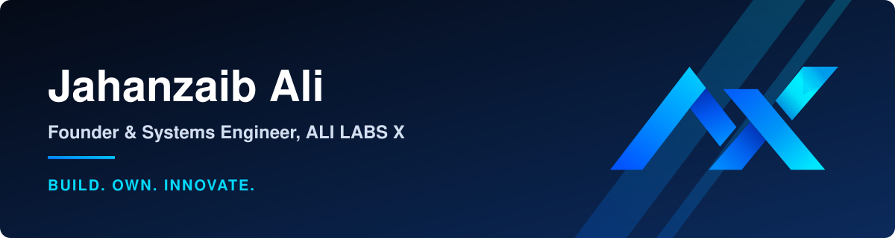

I founded **[ALI LABS X](https://github.com/Ali-Labs-X)**, an independent technology engineering company in Lahore, Pakistan. We build bespoke software, private AI and infrastructure that organizations can own, operate and evolve.

**You define the problem. We engineer the solution.**

## Products

| Product | What it does | Links |
|---|---|---|
| **NOVA BOTS** | A team of long-lived AI bots with roles that share chats and hand work to each other. Cloud or self-hosted. | [Open](https://bots.alilabsx.com) · [Code](https://github.com/Ali-Labs-X/nova-bots) |
| **NOVA** | The agent's computer: watch an AI agent work through its files, terminal, editor and browser. | [Open](https://nova.alilabsx.com) · [Code](https://github.com/Ali-Labs-X/nova) |
| **LOCO** | Open-source local inference lab: one OpenAI-compatible endpoint, predictable routing, and a GPU memory check before a model loads. | [Code](https://github.com/Ali-Labs-X/loco) |
| **STORELOOM** | Commerce platform with storefronts, a visual editor, apps and custom domains. Private and commercial. | [Ask for a demo](mailto:Jahanzaib@alilabsx.com?subject=STORELOOM%20demo) |

## What I work on

- **Agent systems:** long-lived bots, sub-agents, sandboxes and human approval
- **Private AI:** local models, inference routing and retrieval
- **Platform engineering:** authentication, multi-tenancy, Docker, CI/CD and servers
- **Bespoke software:** applications, APIs and automation shaped around an operation

## How I build

- **Fail closed.** A missing check counts as "no".
- **Evidence over claims.** "Done" names what ran and what it showed.
- **Self-hosted by default.** Your data, models and systems stay under your control.
- **Open source with care.** Licences and notices travel with the code.

## More work

- [Exora](https://github.com/Jahanzaib211/exora): self-hosted B2B prospecting CRM
- [Project X](https://github.com/Jahanzaib211/project-x): a brokerage core built in dependency order (archived)
- [Ali Kernel](https://github.com/Jahanzaib211/ali-kernel): single-binary Rust gateway with an OpenAI-compatible API

## Stack

TypeScript, Python, Rust, Node.js, Next.js, FastAPI, PostgreSQL, SQLite, Docker, nginx, Electron, Linux, GitHub Actions.

**[Start a project](mailto:Jahanzaib@alilabsx.com?subject=Project%20enquiry)**
