  

  
  
  
  

  <b>I don't rent, I build.</b> 
  Self-hosted AI systems: AI workforces, agent sandboxes, local inference, and the commerce platform that pays for them. 
  Everything runs on your own hardware, refuses when it can't prove it is safe, and leaves evidence you can check.

---

## 🛠️ What I'm building

<table>
<tr>
<td width="50%" valign="top">

### 🤖 [Nova Bots](https://github.com/Jahanzaib211/nova-bots)
Your self-hosted AI workforce. You create AI workers, give each one a role and a model, and put them in groups. They coordinate on their own: they message each other, hand off work and share group chats.

There's one engine per account behind a fail-closed, multi-tenant portal. My own AI workers fix the product through PRs that carry their evidence ([repair log](https://github.com/Jahanzaib211/nova-bots/blob/dev/docs/repair-log.md)).

</td>
<td width="50%" valign="top">

### 🖥️ [Nova](https://github.com/Jahanzaib211/nova)
The agent's computer: a computer-use agent with sub-agents, memory and a sandbox per thread.

You watch it live through six views: Files, Terminal, Editor, Browser, Activity and Review. Built on DeerFlow with LangGraph and LangChain.

</td>
</tr>
<tr>
<td width="50%" valign="top">

### ⚡ [Loco](https://github.com/Jahanzaib211/loco)
A local inference lab behind one OpenAI-compatible endpoint.

Routing is deterministic, and VRAM-gated admission refuses a model with numbers instead of running out of memory. Memory only changes when you approve it.

</td>
<td width="50%" valign="top">

### 🛍️ Storeloom
The commerce platform for every kind of brand. It's private and commercial.

Each site gets its own database and file store, with templates, a visual editor, apps, custom domains with automatic HTTPS, and paid publishing.

</td>
</tr>
</table>

<b>🔬 More from the lab</b>

 

| Project | What it is |
|---|---|
| [**Exora**](https://github.com/Jahanzaib211/exora) | A self-hosted B2B prospecting CRM. It works from public sources and records where every field came from. |
| [**Project X**](https://github.com/Jahanzaib211/project-x) | A brokerage core built in dependency order. Each module must pass its financial-invariant gates before anything downstream builds on it. |
| [**Ali Kernel**](https://github.com/Jahanzaib211/ali-kernel) | A single-binary Rust gateway with an OpenAI-compatible API, tools, RAG memory and attestation. |

## 💼 Work with me

I take on work where owning the stack matters:

- **Custom AI workforces.** I design AI workers with roles and tools for your team, and set them up on your hardware.
- **Self-hosted AI infrastructure.** Local inference, agent sandboxes, multi-tenant portals, auth.
- **Platform engineering.** Docker, nginx, CI/CD, hardening, and the servers it all runs on.

  
  

## 🤝 Partner

I also work with **Apex Global Tech Solutions** as its Platform Engineer.

## 🧭 How I build

| | |
|---|---|
| 🔒 **Fail closed** | If the GPU can't be measured, no model is admitted. If a session isn't entitled, it gets no engine. A missing check counts as a "no". |
| 🧾 **Evidence over claims** | Every "done" names the command that ran and what it printed. Changes go through branches and PRs. |
| 🤖 **AI workers that ship PRs** | My AI workforce reviews, tests and opens pull requests against its own codebase, and a human approves every merge. |
| 🏠 **I don't rent, I build** | It's self-hosted by default: your data stays on your machine, the models are yours, and nothing is silently substituted. |
| 🙏 **Credit upstream** | Forks and borrowed designs are named in each README and `NOTICE`. |

## 🧰 Stack

  

Also: LangGraph and LangChain, llama.cpp, OpenAI-compatible APIs, MCP.

---

  <a href="https://alilabsx.com"><b>alilabsx.com</b></a> · <a href="mailto:Jahanzaib@alilabsx.com">Jahanzaib@alilabsx.com</a> · <a href="https://www.linkedin.com/in/jahanzaib-ali-labsx">LinkedIn</a>

